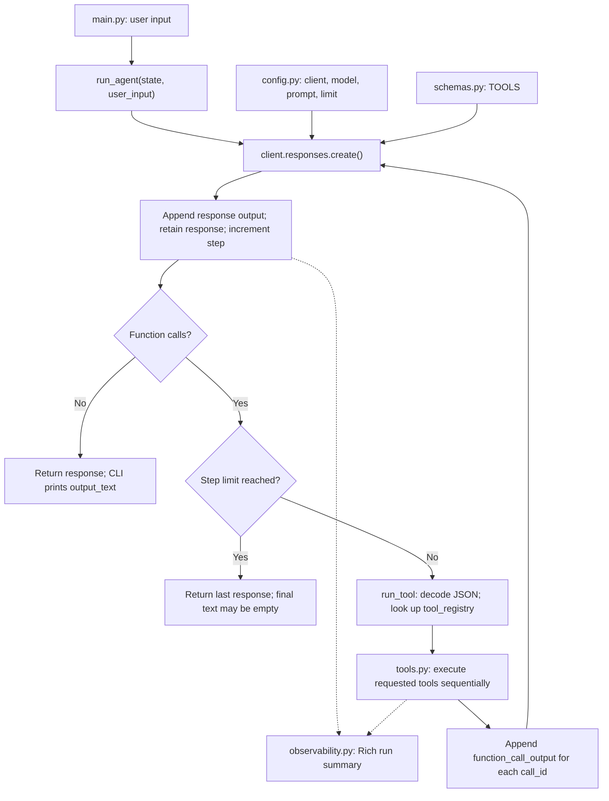

# Mini-Agent

A small Python terminal-agent learning project exploring how an LLM requests
tools, receives their results, and continues a conversation. The hosted version
uses the OpenAI Python SDK through OpenRouter, with explicit orchestration,
JSON tool schemas, a Python tool registry, and a Rich terminal dashboard.
This is an educational prototype, not a production-ready agent framework.

> **Verification scope:** offline regression tests exercise the root CLI,
> tool loop, and Rich dashboard with a fake model client and mocked tools.
> No live hosted-model run is claimed. Read the configuration requirements and
> [limitations](#limitations) before making potentially billable API requests.

## What the code implements

| File | Responsibility |
| --- | --- |
| [main.py](main.py) | Interactive `User:` prompt, one conversation state per process, exit handling, and printing `LLM:` with the returned `output_text`. |
| [agent.py](agent.py) | State creation, model requests, JSON argument decoding, registry dispatch, and the LLM -> tools -> LLM loop. |
| [config.py](config.py) | `.env` loading, OpenRouter client, model identifier, developer prompt, and maximum-step setting. |
| [schemas.py](schemas.py) | The four function-tool descriptions and JSON parameter schemas sent to the model. |
| [tools.py](tools.py) | File and shell operations, plus the `tool_registry` mapping names to Python functions. |
| [observability.py](observability.py) | Rich dashboard rendering and its live-display context manager. |

`create_agent_state()` starts `input_items` with a developer message. Each user
turn appends a user message; each model request appends the returned output items
and retains the raw SDK response in `responses`. Requested tools are executed
sequentially, and each result is appended as a `function_call_output` linked by
`call_id` before the next model request.

The same state is reused across user turns **in memory only**. `step` resets
per turn and counts successful model responses, not individual tool calls.
`MAX_AGENT_STEPS` is currently `10`. If the limit is reached while the model is
still requesting tools, the loop returns that response without executing those
pending calls; a final natural-language answer is not guaranteed.

### Control flow

This diagram shows the orchestration in the source.



## Tools and permission boundary

Paths are interpreted by the host OS. Relative paths use the process working
directory; there is no restriction to a project folder.

| Tool | Actual behavior | Explicit confirmation |
| --- | --- | --- |
| `list_files(path)` | Lists one directory, sorts entry names, and marks directories with a trailing `/`. Returns `(empty directory)` if there are no entries; does not recurse. | None |
| `read_file(path)` | Reads the entire file as UTF-8 text. | None |
| `write_file(path, content)` | Creates or overwrites a UTF-8 text file and returns its path and character count. Does not create missing parent directories. | None |
| `run_command(command)` | Asks for approval, then uses `subprocess.run` with `shell=True` and a 120-second timeout. Returns concatenated stdout and stderr, or a no-output message containing the exit code. | Runs only if the trimmed, case-insensitive reply is `y`. |

**Only `run_command` enforces a user confirmation prompt.** The developer prompt
asks the model to seek permission before changes, but that instruction is not
an enforced permission check for file tools. File reads and writes are not
protected by the shell confirmation. Approved commands run with the host
process's permissions: confirmation and the timeout are **not a sandbox**.
Use only a disposable working copy without sensitive files.

`run_tool()` turns tool exceptions, invalid JSON arguments, and unknown tool
names into error strings returned to the model. This is not a rollback mechanism.

## Terminal display

The Rich dashboard implementation defines an `Agent Run` panel containing:

- A `Coding Agent` header, status, prompt preview, elapsed seconds, model-step
  count, and tool-event count (including errors and declined commands).
- Up to the latest 12 events: `LLM` events list output item types; `TOOL` events
  show the tool name, arguments, and result; `DONE` shows final text; `ERR` shows
  an exception.
- Single-line, truncated previews: prompt 100 characters, tool arguments 160,
  tool results 220, and final text 300.

`main.py` separately prints the returned `response.output_text` after a turn.
The dashboard is a terminal summary, not model-token streaming or durable audit
logging. It does not report token usage or costs. Raw SDK responses remain only
in the in-memory conversation state.

## Prerequisites and configuration

For the hosted root CLI:

- Python **3.12 or newer**; `.python-version` selects 3.12.
- [uv](https://docs.astral.sh/uv/) to install the dependencies in `pyproject.toml`
  using the committed `uv.lock`: `dotenv`, `openai`, `pydantic-ai`, and `rich`.
- An OpenRouter API key, network access, and a model/provider combination that
  supports the Responses API and function-tool calls. Sending a prompt can incur
  provider charges, even if the local CLI subsequently fails.

From the repository root, install the locked environment:

```powershell
uv sync --locked
```

Create an untracked `.env` file in the repository root with your own key:

```dotenv
OPENROUTER_API_KEY=replace_with_your_own_key
```

`config.py` calls `load_dotenv()` and reads `OPENROUTER_API_KEY` from the
environment. `.env` is ignored by Git; never commit a real key or include it in
terminal screenshots.

The following settings are **Python constants in `config.py`**, not environment
variable options:

```python
MODEL = "~openai/gpt-latest"
MAX_AGENT_STEPS = 10
```

The client base URL is hard-coded to `https://openrouter.ai/api/v1`.
Check the configured model identifier and Responses API/tool support for your
account before using it; provider compatibility and this model identifier have
not been verified here. To select a different model, edit `MODEL` in `config.py`.
Do not assume that adding a model name to `.env` changes this setting.

### Entry points

Run the supported source entry point from the repository root:

```powershell
uv run python main.py
```

This launches the hosted CLI; an API key is required when its configuration
module is imported. At the `User:` prompt, blank input is skipped;
`exit`, `quit`, or `q` ends the
conversation, as do EOF or Ctrl+C while waiting for input.

Other paths in the repository are distinct:

| Entry/path | Status |
| --- | --- |
| `mini-agent` | No console script is registered. Use the root source command above, not an installed package command. |
| `src\mini_agent\__init__.py` | Unused greeting scaffold, not the agent runtime. |
| `uv run python local.py` | Separate Pydantic-AI/Ollama experiment, configured for `gemma4:26b` at `http://localhost:11434/v1`. Requires a separately running Ollama server with that model available. Its tools are local time, arithmetic, and file reading/writing, not the hosted runtime's four-tool registry; it has no file-write confirmation prompt. This alternative has not been verified here. |
| `Earlier_Stages` | Earlier learning snapshots, not the default entry point. |

### Example request, not a recorded run

A simple request to try at `User:` after configuring the hosted client is:

```text
Read README.md and summarize the project's purpose and limitations in two sentences. Do not edit files or run shell commands.
```

The intended tool path is `read_file` -> `function_call_output` -> model summary,
but tool selection and response wording depend on the model. This is not a
captured transcript or a permission guarantee, and no generated output is
claimed.

## Offline regression checks

From the repository root, in an environment with Rich installed:

```powershell
python -m unittest discover -s tests -v
```

Prefix the command with `uv run` to use the project's environment. The tests
replace the configuration module before importing the runtime, use a fake
Responses client and mocked file tool, and render the real Rich dashboard to an
in-memory console. They do not load `.env`, read real credentials, make model
requests, or execute actual file/shell tools.

Coverage includes no-tool completion, a tool-result round trip, the step limit,
model and tool exceptions, invalid tool dispatch, conversation state across
turns, and the root CLI's output/exit path. These are regression checks, not a
model-quality evaluation or proof of provider compatibility.

## Limitations

| Area | Current limitation |
| --- | --- |
| Distribution | The supported CLI is run from a source checkout. No packaged console command is provided; the package scaffold is not connected to the runtime. |
| Hosted compatibility | The configured OpenRouter model identifier and Responses API/tool support need to be checked; no successful hosted run is asserted here. Model-request exceptions are re-raised, not recovered by the CLI. |
| File and shell access | No sandbox, path allowlist, or enforced file read/write approval. Shell approval does not isolate an approved command from the host. |
| Conversation growth | Full inputs and raw responses accumulate without context trimming or persistence; restarting the process loses conversation state. |
| Step limit | Bounds model responses per turn, not total tool calls, total session requests, or spending. Stopping at the limit can return incomplete or empty final text. |
| Evidence and maturity | Offline regression tests cover orchestration, not model quality or live provider integration. No benchmark results or production deployment is provided. The terminal summary is not a durable log or token/cost tracker. |

This README is based on source inspection and offline regression checks. No
hosted-model API call or tool-executing agent demo was run to produce it.